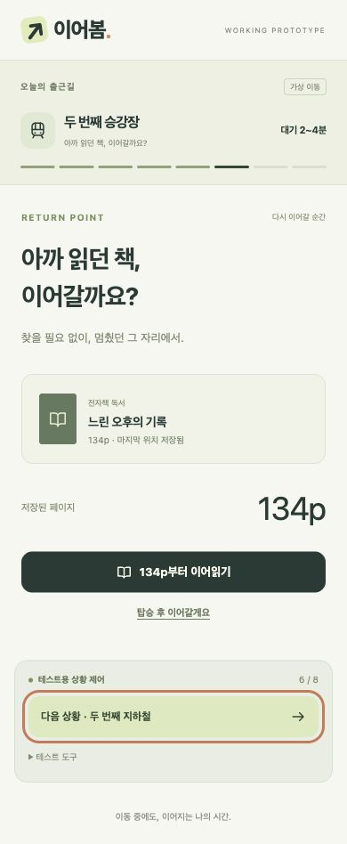

# 제출 전 최종 검증

검증일: 2026-10-12. 실제 사용자 연구 결과가 아닌 구현 기능 점검 기록입니다.

## 자동 검사

- Node.js 내장 테스트 러너: 11개 통과, 0개 실패.
- JavaScript 구문 및 필수 배포 파일 검사 통과.
- 새 회귀 테스트 3개는 수정 전 실패를 재현하고 수정 후 통과했습니다.

## 브라우저 수동 점검 항목

| 흐름 | 확인 항목 |
|---|---|
| 출근 | 시작 → 도보 → 승강장 대기 → 탑승 후 시작 → 134p까지 이동 → 환승 안내 → 저장 → 도보 환승 → 134p 복귀 → 재탑승 → 135p → 새로고침 후 135p 복원 → 종료 |
| 출근 분기 | 승강장에서 먼저 읽기, 수동 저장 없이 자동 저장, 복귀 미루기 |
| 퇴근 | 오후 6:30 알림 → 도보 → 동료 메시지 → SNS → 복귀 알림 → 이전 시청 시간부터 재개 → 첫 지하철 → 환승 중단 → 동일 시청 위치 복귀 → 두 번째 지하철 → 하차 |
| 선택권 | 퇴근 복귀 알림 거절 후 다시 선택 가능, 도보·환승에는 활동 강요 없음 |
| 저장 | 책 페이지와 모의 영상 시청 시간이 각자 유지됨, 새로고침 후 자동 재생하지 않음 |
| 초기화 | 취소 시 위치 유지, 실행 시 출근 시작 화면·132p·00:42:18 복원 |
| 홈 | 로고를 누르면 기존 시작 화면으로 복귀하며 콘텐츠 위치 유지 |

## 배포 확인 — 완료 (2026-10-12)

- GitHub Public: https://github.com/maeeoong/ieum-working-prototype
- Vercel Production: https://ieum-working-prototype.vercel.app/
- 쿠키·계정 인증 없이 HTTP 200 응답 확인. HTTPS 화면 정상 표시.
- GitHub에서 내려받은 17개 소스·문서가 원본과 일치. 해당 복사본에서 자동 테스트 11개와 배포 파일 검사 통과.
- 공개 사이트: 먼저 읽기 → 134p → 환승 자동 저장 → 134p 한 번 눌러 복귀 → 새로고침 후 134p 보존 확인.
- 공개 사이트: 퇴근 알림 → 메시지 → SNS → 복귀 알림 → 42:18 모의 시청 → 19분 진행 → 환승 시 01:01:24 저장 → 같은 위치 복귀 → 재탑승 → 하차 요약 확인. 모의 타이머로 흐른 초가 포함됩니다.
- 공개 사이트 브라우저 콘솔 오류 없음. 390px 화면에서 복귀 화면 확인.
- 아래 화면은 실제 배포 주소에서 촬영했습니다.

## 검증 한계

- 브라우저의 모바일 화면 크기에서 확인하며 실제 iPhone·Android 기기 검수는 별도입니다.
- 영상은 모의 타이머입니다. 실제 영화·음성 재생, 스트리밍 품질은 검증 범위가 아닙니다.
- 실제 참여자의 복귀 성공률·만족도는 측정하지 않았습니다.
